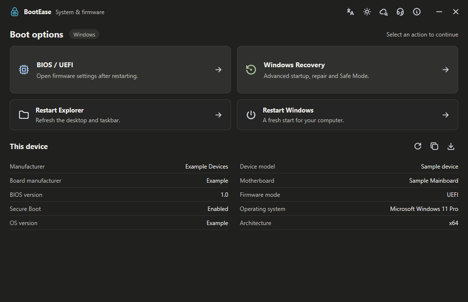
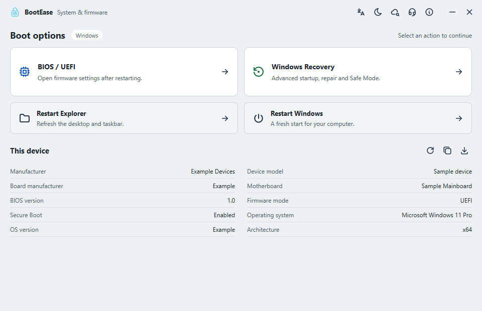
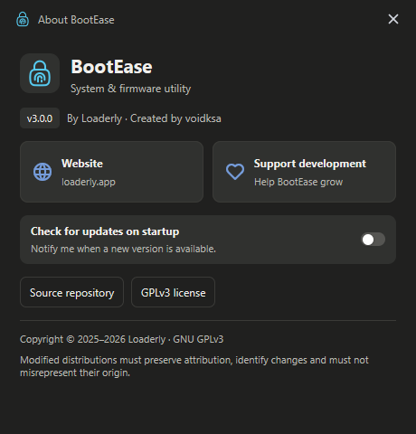

<h1>BootEase 3.0.0</h1>

A Loaderly product · Created by voidksa

<a href="README.md">English</a> · <a href="README_AR.md">العربية</a>

BootEase is a lightweight Windows utility for firmware, recovery and restart options, with device information in one compact interface.

## Download

- [Installer for Windows x64](https://github.com/voidksa/BootEase/releases/download/v3.0.0/BootEaseSetup-3.0.0-x64.exe)
- [Portable ZIP for Windows x64](https://github.com/voidksa/BootEase/releases/download/v3.0.0/BootEasePortable-3.0.0-x64.zip)
- [Releases and checksums](https://github.com/voidksa/BootEase/releases)

Requires Windows 10 or Windows 11, x64. Direct firmware entry requires UEFI. Glass appearance depends on Windows support and transparency settings.

## Features

- Open BIOS/UEFI settings or Windows Recovery after confirmation.
- Restart Windows or restart Windows Explorer.
- View device, motherboard, BIOS, Secure Boot and Windows information.
- Copy system information or save it as a text report.
- English and Arabic, including right-to-left layout.
- Light and dark appearance with subtle interaction animations.
- Check for updates manually, or enable optional checks on startup in About.
- A notification and upgrade indicator when a newer release is found.

## Interface

These images are rendered from the application UI using sample device data. Windows glass effects may differ on your computer.

## Use

Install BootEase using the installer, or unpack the portable ZIP and open `BootEase.exe`, keeping its accompanying files together. Choose an action and read its confirmation before continuing. Save your work before restarting Windows or entering firmware or recovery settings.

The globe-language button switches English/Arabic. The sun or moon switches appearance. Use About to enable startup update checks, visit the website or support development. Automatic checks are off by default and do not install updates. The save dialog follows Windows language preferences; the report follows the app language.

## Website and support

- [Loaderly](https://loaderly.app)
- [Contact support](https://loaderly.app/contact/)
- [Support development](https://creators.sa/en/voidksa)

## License

BootEase is owned and maintained by Loaderly, originally developed by voidksa. Licensed under [GNU GPLv3](LICENSE). See [attribution](NOTICE.md).
