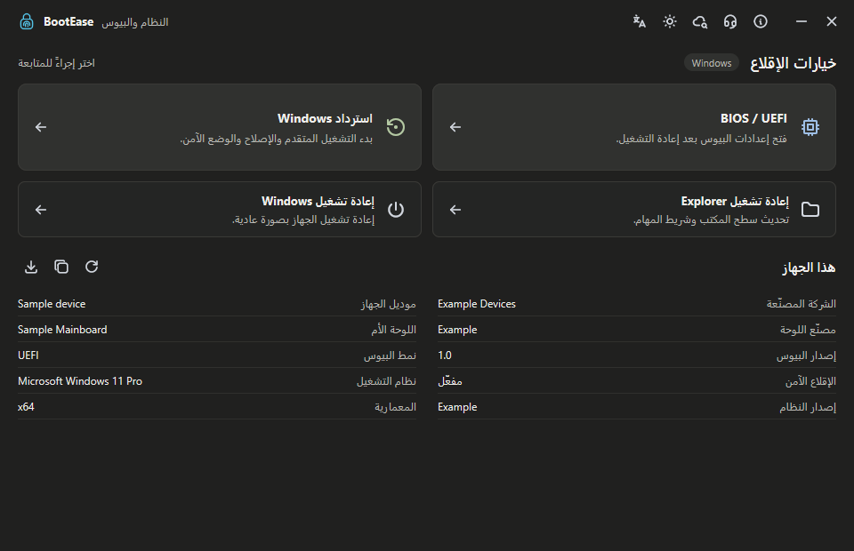
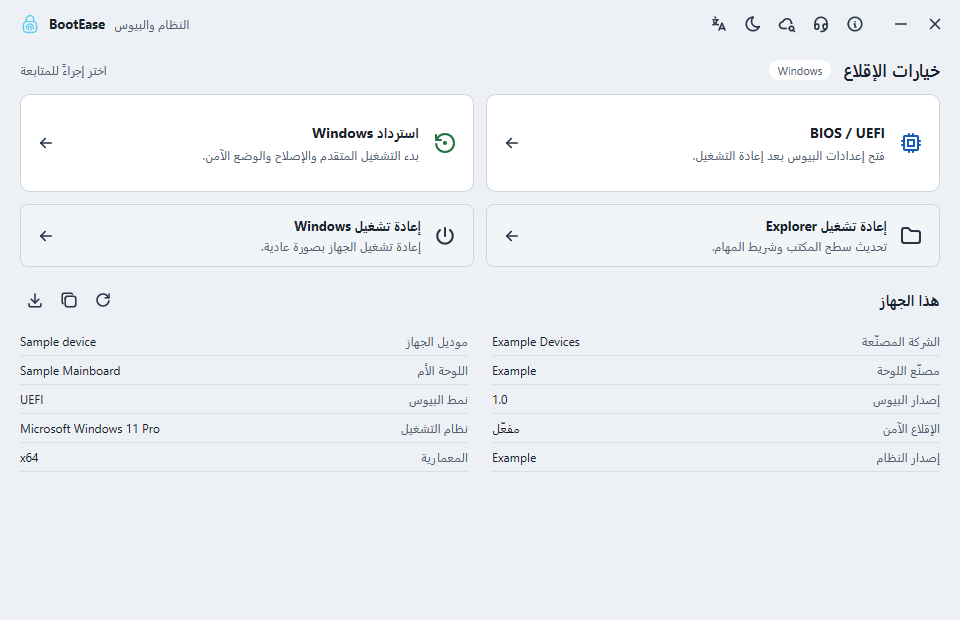
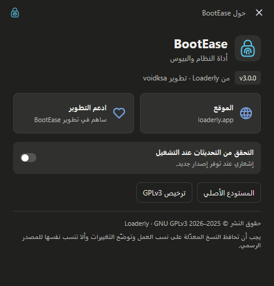

<h1>BootEase 3.0.0</h1>

A Loaderly product · Created by voidksa

<a href="README.md">English</a> · <a href="README_AR.md">العربية</a>

BootEase أداة خفيفة لنظام Windows تجمع خيارات البيوس والاسترداد وإعادة التشغيل ومعلومات الجهاز في واجهة مدمجة.

## التحميل

- [المثبّت لنظام Windows x64](https://github.com/voidksa/BootEase/releases/download/v3.0.0/BootEaseSetup-3.0.0-x64.exe)
- [النسخة المحمولة ZIP لنظام Windows x64](https://github.com/voidksa/BootEase/releases/download/v3.0.0/BootEasePortable-3.0.0-x64.zip)
- [الإصدارات وبصمات الملفات](https://github.com/voidksa/BootEase/releases)

يتطلب Windows 10 أو Windows 11 بمعمارية x64. الدخول المباشر إلى إعدادات البيوس يتطلب UEFI. المظهر الزجاجي يعتمد على دعم Windows وإعدادات الشفافية.

## الميزات

- الدخول إلى BIOS/UEFI أو استرداد Windows بعد التأكيد.
- إعادة تشغيل Windows أو مستكشف الملفات Explorer.
- عرض معلومات الجهاز واللوحة الأم والبيوس والإقلاع الآمن والنظام.
- نسخ معلومات الجهاز أو حفظها في تقرير نصي.
- العربية والإنجليزية مع دعم اتجاه القراءة العربي.
- مظهر فاتح وداكن وحركات تفاعل خفيفة.
- التحقق اليدوي من التحديثات، مع خيار التحقق عند التشغيل من نافذة «حول التطبيق».
- إشعار ومؤشر ترقية عند العثور على إصدار أحدث.

## الواجهة

هذه صور مرسومة من واجهة التطبيق ببيانات جهاز توضيحية. قد يختلف المظهر الزجاجي على جهازك.

## الاستخدام

ثبّت التطبيق باستخدام المثبّت، أو فك ضغط النسخة المحمولة وافتح `BootEase.exe` مع إبقاء الملفات المرفقة معه. اختر الإجراء واقرأ رسالة التأكيد قبل المتابعة. احفظ عملك قبل إعادة تشغيل Windows أو الدخول إلى البيوس أو الاسترداد.

زر اللغة يبدّل بين العربية والإنجليزية، وزر الشمس أو القمر يبدّل المظهر. من «حول التطبيق» يمكنك تفعيل التحقق عند التشغيل أو زيارة الموقع أو دعم التطوير. التحقق التلقائي مغلق افتراضيًا ولا يثبّت التحديثات. نافذة الحفظ تتبع لغة Windows، والتقرير يتبع لغة التطبيق.

## الموقع والدعم

- [Loaderly](https://loaderly.app/ar)
- [التواصل مع الدعم](https://loaderly.app/ar/contact/)
- [دعم التطوير](https://creators.sa/ar/voidksa)

## الترخيص

التطبيق مملوك وتحت صيانة Loaderly، والمطوّر الأصلي voidksa. مرخّص بموجب [GNU GPLv3](LICENSE). راجع [نسب العمل](NOTICE.md).
